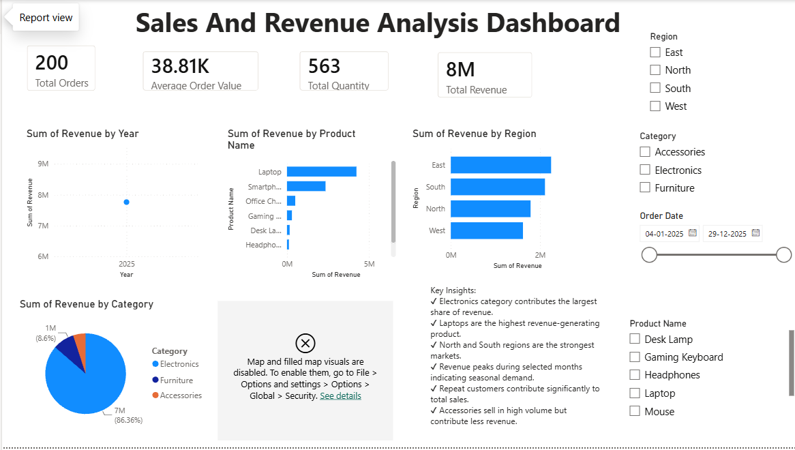

# 📊 Retail Sales Performance Dashboard (Power BI)

An interactive end-to-end **Power BI Sales Analytics Dashboard** built to analyze 2025 retail order performance across product categories, regions, and customer segments.

---

## 🎯 Project Objective
The goal of this project is to transform raw transactional sales data (`200 orders` across `FY 2025`) into actionable business insights—helping stakeholders track revenue drivers, regional performance, monthly sales trends, and high-value product categories.

---

## 📁 Dataset Overview
- **Time Period:** January 2025 – December 2025
- **Total Records:** 200 Transactions (`ORD0001` – `ORD0200`)
- **Columns:** `Order ID`, `Order Date`, `Product Name`, `Category`, `Quantity`, `Unit Price`, `Revenue`, `Customer Name`, `Region`
- **Product Categories:** Electronics, Furniture, Accessories
- **Regions Covered:** North, South, East, West

---

## 🛠️ Tools & Techniques Used
- **Power BI Desktop:** Interactive report design, slicers, KPI cards, and drill-down visuals
- **Power Query (ETL):** Data type standardization, date formatting, and validation checks (`Quantity × Unit Price = Revenue`)
- **DAX (Data Analysis Expressions):** Custom calculated measures for Total Revenue, Total Orders, Total Units Sold, Average Order Value (AOV), and Month-over-Month (MoM) growth

---

## 📈 Key Business Metrics (KPIs)
| Metric | Value |
| :--- | :--- |
| **Total Revenue** | ₹73,50,100 |
| **Total Orders** | 200 |
| **Total Quantity Sold** | 577 Units |
| **Average Order Value (AOV)** | ₹36,750.50 |
| **Top Revenue Category** | Electronics (₹65,24,000 / ~88.8%) |
| **Top Performing Region** | East (₹21,04,700) |

---

## 💡 Key Insights & Findings
1. **Category Dominance:** **Electronics** drives **88.8%** of total revenue (`₹65.24L`), led by high-ticket items like **Laptops** (`₹38.50L`) and **Smartphones** (`₹25.50L`), despite accounting for 45% of order volume.
2. **Regional Performance:** **East** leads overall revenue (`₹21.05L`), followed closely by **North** (`₹18.37L`), **South** (`₹17.16L`), and **West** (`₹16.93L`).
3. **High-Volume vs. High-Value Products:** **Desk Lamps** (`104 units`) and **Mice** (`76 units`) lead in unit volume, whereas **Laptops** (`70 units`) and **Smartphones** (`102 units`) generate the highest revenue contribution.
4. **Seasonality:** Sales peak during **July (`₹8.61L`)**, **August (`₹8.43L`)**, and **October (`₹8.17L`)**, making Q3 and early Q4 the strongest revenue quarters.

---

## 🖼️ Dashboard Preview


---

## 📂 Repository Structure
```text
├── Retail_Sales_Dashboard.pbix    # Power BI Report File
├── sales_data_2025.csv            # Raw Dataset
├── sales_revenue.png              # Dashboard Visual Preview
└── README.md                      # Project Documentation
